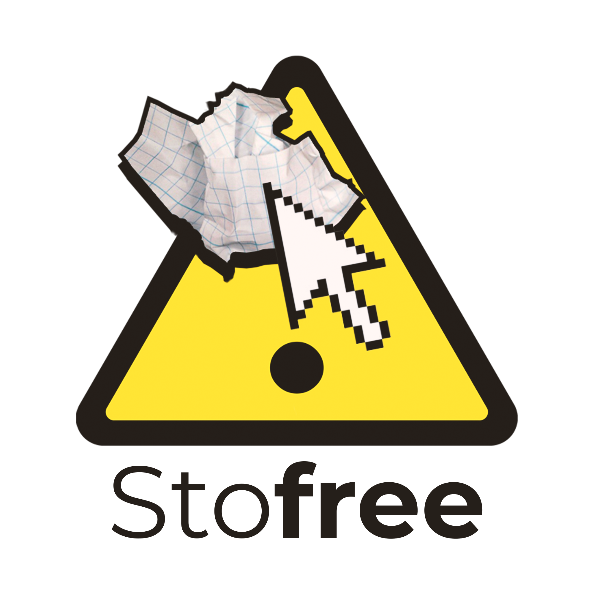

<p align="center">
  
</p>

<h3 align="center">Windows Disk Space Analyzer</h3>

**Stofree** shows you where your disk space went. It scans a drive or folder, then lets you explore
folder sizes, find the largest files, see storage by file type, and export the results to CSV/JSON.

Stofree is **strictly read-only**: it never deletes, moves, renames or modifies anything, and it
never opens file contents - only names, sizes and folder structure are read.

## Features

- **Dashboard** - every Windows drive with capacity, used/free space, usage %, animated usage bars,
  a donut chart and last-scan information.
- **Drive Scanner** - background scan with live progress, current folder, file/folder counters,
  elapsed time, cancellation, and a log of skipped links and access errors.
- **Largest Files** - the biggest files found, with sorting (largest / smallest / name / type),
  a search box and a category filter. Backed by a table model, so it stays fast with large results.
- **Folder Explorer** - sortable folder tree with size, share of parent, file and sub-folder counts,
  plus a folder-size comparison chart.
- **File Types** - storage and share per category (Images, Videos, Audio, Documents, Applications,
  Archives, Development, Other) with a donut chart and a per-extension table.
- **Reports** - CSV (files, folders) and JSON export with drive, path, size, type and scan timestamp.
- **Settings** - dark / light / system theme, animations, number of largest files kept, removable
  drives, log folder, About.
- **Branding** - theme-aware Stofree wordmark (dark/light variants), `logo.png` loading screen with
  animated `Ani.gif`, application and taskbar icon.

## Screenshots

> Placeholders - add your own captures to `docs/screenshots/`.

| Dashboard | Folder Explorer | File Types |
|---|---|---|
| `docs/screenshots/dashboard.png` | `docs/screenshots/explorer.png` | `docs/screenshots/types.png` |

## Technology

Python 3.11+, PySide6 (Qt 6: GUI, Qt Charts, QMovie), `os.scandir`/`pathlib`, `psutil` and `shutil`
for drive information, `QThread` workers, `pytest` / `pytest-qt`.
Optional for building: Pillow (icon generation) and PyInstaller (executable).

## Installation (Windows 10 / 11)

1. Install **Python 3.11 or newer** from <https://www.python.org/downloads/>
   (tick *"Add python.exe to PATH"*).
2. Open **PowerShell** in the project folder and run:

```powershell
py -3.11 -m venv .venv
.\.venv\Scripts\Activate.ps1
pip install -r requirements.txt
```

If PowerShell blocks activation, run `Set-ExecutionPolicy -Scope Process RemoteSigned` once, or use
`.\.venv\Scripts\activate.bat` from Command Prompt.

## Run Stofree

```powershell
python main.py
```

Stofree does **not** need administrator rights. Folders Windows protects (for example
`System Volume Information`) are reported as access errors and skipped; they never stop the scan.

| Option | Effect |
|---|---|
| `python main.py --no-splash` | Start without the animated splash screen |
| `STOFREE_NO_SPLASH=1` (environment variable) | Same, without a command-line flag |

## Run the tests

```powershell
pip install pytest pytest-qt
python -m pytest
```

The GUI tests run headless (Qt `offscreen` platform) and only ever touch temporary directories.
One test (a real NTFS junction) runs on Windows only and is skipped elsewhere.

## Branding and assets

| File | What it is | Used for |
|---|---|---|
| `assets/branding/logo.png` | Square emblem (triangle, cursor, paper + wordmark) | **Loading screen**, **main logo**: window / taskbar / executable icon, About section, collapsed-sidebar icon |
| `assets/branding/darkmode_logo.png` | White wordmark | **Dashboard header and sidebar in dark mode** |
| `assets/branding/lightmode_logo.png` | Dark wordmark | **Dashboard header and sidebar in light mode** |
| `assets/branding/Ani.gif` | 4-frame animation | Loading indicator on the splash screen (played with `QMovie`) |
| `assets/branding/stofree.ico` | Multi-resolution Windows icon | Executable icon (generated from `logo.png`) |

- The supplied artwork is used **as-is** and is never modified. Automated tests pin the SHA-256
  checksum of every supplied file so accidental changes are caught.
- The wordmark in the dashboard header and sidebar switches **live** when you change the theme
  (Settings, the sun/moon button, or "Follow system"). If a themed image is missing, Stofree falls
  back to the plain text name in the theme's text colour.
- `logo.png` is designed for light backgrounds (dark outline and lettering), so the splash card is
  light, and in the About section it sits on a light badge.
- The window/taskbar icon is composed at run time from `logo.png`: only the empty transparent margins
  are trimmed; proportions and transparency are preserved. On a dark taskbar the emblem's black
  outline blends in, while the yellow triangle and cursor stay clearly visible.
- `stofree.ico` is regenerated by `python tools/make_icon.py` (needs Pillow) using the same
  composition. It reads `logo.png` read-only.
- On Windows the process sets its own AppUserModelID (`Stofree.DiskSpaceAnalyzer`) so the taskbar
  shows the Stofree icon rather than Python's.

### Splash screen behaviour

The splash is created once at start-up. It shows `logo.png` with `Ani.gif` playing beside it at its
original aspect ratio, and closes automatically when the dashboard is ready (after at least ~1.4 s so the animation is actually seen).
Drive detection runs on a worker thread, so the animation never freezes. If the GIF cannot be loaded
the splash shows the logo alone; if no artwork loads at all, Stofree simply opens the main window.

### Asset loading

`app/utils/assets.py` resolves paths relative to the project (development), `sys._MEIPASS`
(PyInstaller) or the `STOFREE_ASSETS` environment variable. Missing or corrupt images return `None`
instead of raising, and no absolute paths are hard-coded.

## Build a Windows executable

```bat
build_windows.bat
```

This creates a virtual environment, installs build requirements, regenerates the ICO and runs
PyInstaller with `packaging/stofree.spec`, producing `dist\Stofree\Stofree.exe`. The spec bundles the
whole `assets/` folder and applies `stofree.ico` plus Windows version information.

## Project architecture

```
Stofree/
├── main.py                  entry point (--no-splash)
├── app/
│   ├── launcher.py          splash -> main window sequencing, Windows taskbar identity
│   ├── main_window.py       sidebar (logo + navigation) and stacked pages
│   ├── state.py             shared state: drives, scan result, settings, last-scan info
│   ├── theme.py             dark / light palettes and stylesheet
│   ├── ui/                  dashboard, scanner, largest_files, folder_explorer, file_types,
│   │                        reports, settings, branding (logo/icon), splash, widgets, icons
│   ├── core/                drive_manager, disk_scanner, file_analyzer, folder_analyzer,
│   │                        report_generator  (no GUI imports)
│   ├── workers/             scan_worker (scanning thread), drive_worker (drive detection)
│   └── utils/               assets, constants, formatters, logger
├── assets/branding/         logo.png, darkmode_logo.png, lightmode_logo.png, Ani.gif, stofree.ico
├── assets/icons/            UI icons (SVG)
├── packaging/               PyInstaller spec + Windows version info
├── tools/make_icon.py       ICO generator
└── tests/                   core, GUI-integration, branding/splash and asset tests
```

The internal Python package is still called `app`; only user-facing names changed to Stofree.

## Safety

- Read-only: no deleting, moving, renaming, formatting or modifying - the only files ever written are
  the reports you explicitly save, plus a log file in `%LOCALAPPDATA%\Stofree\logs`.
- File contents are never read; only metadata from `os.scandir`.
- Symbolic links, junctions, mount points and other reparse-point **directories** are never followed
  (no loops, no double counting). Link-like files are skipped too.
- Cancelling stops further traversal immediately and keeps the partial results.

## Known limitations

- Sizes are logical file sizes, not "size on disk"; hard links are counted per path.
- Reparse-point directories are skipped by design, so content under e.g. OneDrive folders that Windows
  exposes as reparse points may not be counted.
- Developed and automatically tested on Linux using Qt's headless platform. Windows-specific code
  (drive labels, junction detection, taskbar ID, ICO, PyInstaller build) follows documented Windows APIs,
  but the packaged `.exe` has **not** been built or run on Windows by the author of this change.
  Please run `python -m pytest` and `build_windows.bat` on your machine.
- The wordmark and icon were checked visually only in Qt's headless renderer, not on a real Windows
  display or taskbar.

## Future improvements

Treemap view, scan history and comparison, size-on-disk and duplicate detection, an MFT-based fast
scanner for NTFS, localisation, and an installer (MSI/Inno Setup).
